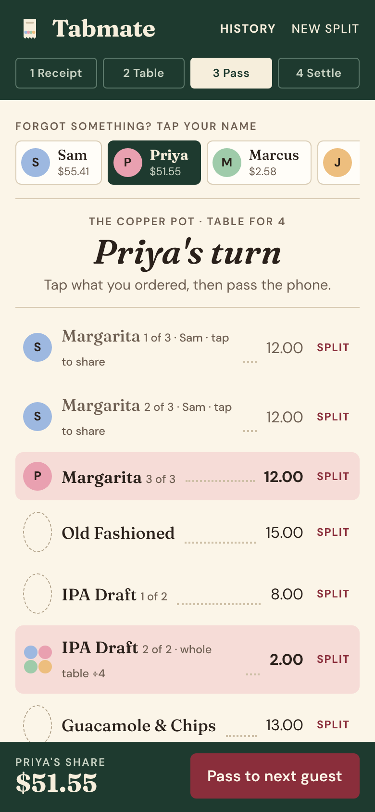
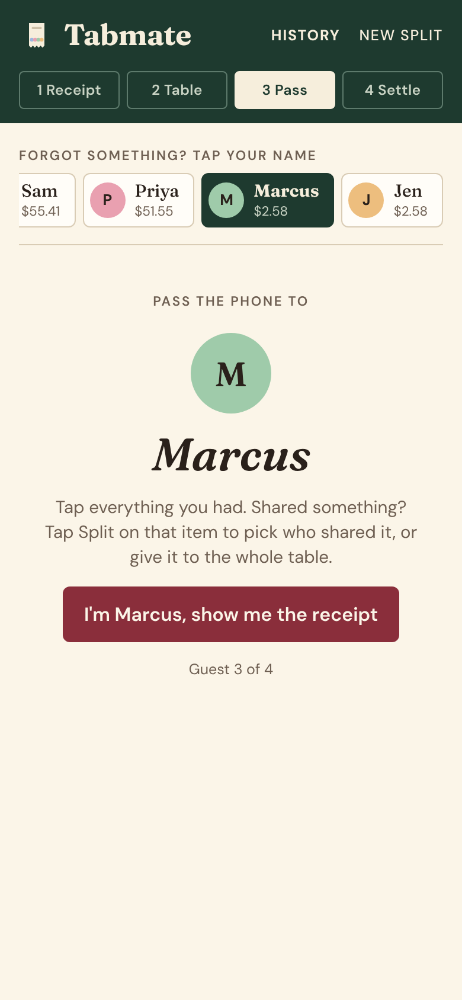
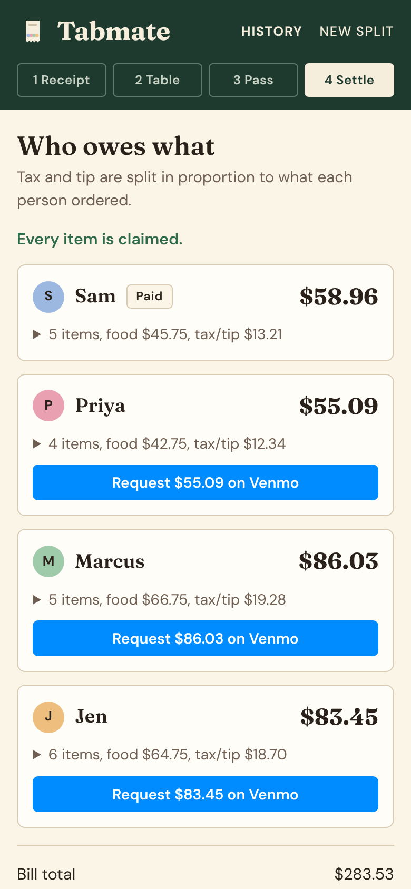

  

<h1 align="center">TabMate</h1>

  <b>Split the check by passing one phone around the table.</b> 
  Everyone taps what they had. TabMate does the tax, the tip and the Venmo requests.

  <a href="https://alessioandolina.github.io/TabMate/"><b>Open TabMate</b></a>

  
  &nbsp;
  
  &nbsp;
  

## Why

The check comes, someone pays, and then the math begins. TabMate turns that into a quick game of pass the phone. Only the person who paid needs it. Nobody else downloads anything or makes an account.

## How it works

1. **Paste the receipt.** When the card reader texts you a receipt, copy the text and paste it in. TabMate reads every item, plus tax and any discounts. Three margaritas become three separate items, so each person can claim their own.
2. **Set up the table.** Add everyone now, or let each person type their own name and Venmo when the phone reaches them.
3. **Pass the phone.** Each person taps what they ordered. Shared the guac? Tap **Split** to pick who shared it, or give it to the whole table. Forgot something? Tap your name at the top to jump back to your turn.
4. **Settle up.** Tax and tip are split in proportion to what each person ordered, rounded so everyone's share adds up to the exact bill. Tap **Request on Venmo** for each person, or copy a summary for the group chat.

## Features

- Reads texted receipts from Square, Toast and other card readers
- Tip presets (18 to 25%) or a custom amount, plus tax and discounts
- Split any item between a few people or the whole table
- Colored avatars, so you can see at a glance who has what and what's still unclaimed
- Jump back to anyone's turn if they forgot an item
- Venmo request links with the amount and note filled in
- History of your past splits, with the option to reopen one or send the requests again

## Add it to your home screen

- **iPhone:** open the link in Safari, tap Share, then **Add to Home Screen**.
- **Android:** open the link in Chrome, tap the menu, then **Add to Home screen**.

It gets the TabMate icon and opens full screen, like an app.

## Privacy

Everything stays on your phone. Receipts, names and History are saved in your browser and never sent anywhere. TabMate never touches money: the Venmo buttons open Venmo with the request filled in, and you send it from there.

## Built with

One HTML file of plain HTML, CSS and JavaScript, hosted free on GitHub Pages. No frameworks, no server, no tracking.
